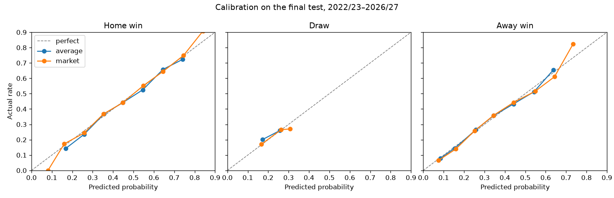
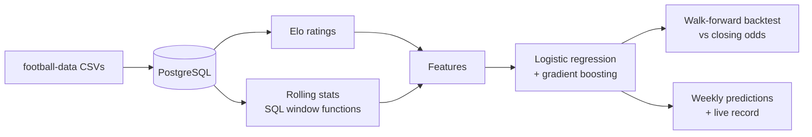

# Football Odds Predictor

Win, draw and loss probabilities and fair odds for Premier League and Championship
matches, tested against bookmakers' closing odds and published automatically twice a week.

**[Open the live app](https://football-odds-predictor-billygeros.streamlit.app/)**: upcoming predictions, the live record, season chances, team ratings and model performance.

**Python · PostgreSQL · SQL window functions · scikit-learn · Streamlit · GitHub Actions**

## Results

The models were tested **walk-forward**: each season is predicted using only the seasons
before it. Every choice (Elo settings, features, model settings) was made on 2019/20–2021/22.
The final test below was then run **once** on matches never used for any decision:
2022/23 to 2026/27 up to 8 November 2026, **3,986 matches**. These numbers are fixed:
the test is not rerun as new matches are played.

| Model | Log loss | Brier score | Calibration error |
|---|---:|---:|---:|
| Bookmakers' closing odds | **1.0054** | **0.6019** | 0.0092 |
| Logistic regression | 1.0219 | 0.6129 | 0.0088 |
| **Average of logistic and boosting (main model)** | 1.0229 | 0.6134 | 0.0096 |
| Gradient boosting | 1.0270 | 0.6156 | 0.0092 |
| Baseline (historical home/draw/away rates) | 1.0733 | 0.6494 | — |

Lower is better for all three. Calibration error is the average gap between predicted and actual rates.

- **The model closes 74% of the gap** between the baseline and the closing odds.
- **Its probabilities are as well calibrated as the bookmakers'**: when it says 60%, the outcome happens about 60% of the time.
- **It does not beat the market**, which was expected. Closing odds include team news, line-ups and the money of everyone betting.



**An honest note:** the average of the two models was chosen because it was best on the
tuning seasons (1.0271 against 1.0292). On the final test, logistic regression alone was
slightly better (1.0219 against 1.0229). The difference is within noise, and switching
models after seeing the final test would defeat its purpose, so the average stays.

Full numbers, including each season, are in [`results/metrics.json`](results/metrics.json).

## Live record

Since November 2026 a GitHub Actions workflow predicts upcoming matches every Monday and
Thursday. Each run's predictions are committed to [`predictions/`](predictions/), so the
public git history records when each was made, before kick-off. Once the matches are played,
[`src/live_score.py`](src/live_score.py) scores them against two benchmarks on the same games:

- **pre-match odds**: the market average recorded before the matches, closer to when the model predicts
- **closing odds**: the final market price at kick-off

*No live results yet: this section will be updated once the first predicted matches are played.*

## How it works



1. **Data.** Results, shots on target and market odds for every Premier League and
   Championship match since 2015/16 (over 10,500 matches, 59 teams), loaded into PostgreSQL.
   Reloading is safe: new matches are added, and stored ones are updated in place
   (`ON CONFLICT DO UPDATE`), so a result the source corrects later is picked up.
2. **Elo ratings.** One strength number per team, updated after every match. Both leagues
   share one scale, so promoted and relegated teams carry their rating with them. Two
   additions, both tuned: bigger wins move ratings more, and each summer every rating moves
   40% of the way back to its league's average.
3. **Features.** Each team's averages over its previous 5 matches, computed in SQL with
   window functions (`ROWS BETWEEN 5 PRECEDING AND 1 PRECEDING`), so a match never sees its own result.
4. **Models.** Logistic regression and gradient boosting on the Elo difference and shots on
   target, averaged. Odds are never used as inputs, only as the benchmark.
5. **Fair odds.** Odds are `1 / probability`, with no bookmaker margin.

## What I found

Each step was measured on the tuning seasons (log loss, lower is better):

| Step | Change | Log loss |
|---|---|---:|
| Start | Logistic regression on plain Elo | 1.0348 |
| Elo | Margin of victory and the summer pull-back | 1.0309 |
| Features | Added shots on target | 1.0293 |
| Boosting | Tuned: few, shallow trees learning slowly (from 1.0528) | 1.0292 |
| Final | Average of logistic and boosting | **1.0271** |

- **How ratings move matters more than the settings.** Home advantage changed log loss by
  less than 0.0002, because the model learns home advantage itself. Margin of victory and
  the summer pull-back gave the real gains.
- **Shots on target beat goals.** They measure how often a team creates real chances, which
  predicts better than the scorelines. Adding recent goals made the model slightly worse.
- **More features are not automatically better.** Using every feature was worse than Elo plus shots on target.
- **Boosting needed to be kept simple.** Untuned, it was worse than logistic regression;
  heavily restrained, it matched it.

The data behind these choices, including home advantage disappearing in the Premier League
without crowds in 2020/21 and how well calibrated the market is, is explored in
[notebooks/exploration.ipynb](notebooks/exploration.ipynb).

## Limitations

- **The live comparison favours the market.** A prediction can be made up to four days
  before kick-off, while closing odds include late team news. The pre-match odds are the fairer comparison.
- **Predictions are saved only up to 2 hours before kick-off** (UK kick-off times converted
  to UTC), so every saved prediction is made well before the match. Games kicking off
  sooner than that when a run happens are not predicted.
- **Rescheduled matches** are matched on season and both teams, so they still find their
  result. If a match was predicted twice, the prediction made for the official date counts,
  and the replaced one is reported, not hidden.
- **No line-ups, injuries or xG.** The model only knows results, shots on target and ratings.
- **Data** comes from [football-data.co.uk](https://www.football-data.co.uk) and is not
  included in this repository. This is a personal, non-commercial project.

## Project structure

```text
├── .github/workflows/update.yml   Monday and Thursday: download, load, rate, predict, publish, score, simulate
├── sql/
│   ├── schema.sql                 tables: teams, matches, odds, elo_ratings, predictions
│   ├── features.sql               match_features view: Elo + previous-5-match averages
│   ├── team_current.sql           team_current view: each team's form right now
│   ├── live_record.sql            live_record view: predictions next to results and odds
│   └── season_simulations.sql     each simulation run's chances for every team
├── src/
│   ├── download.py                current season and fixtures
│   ├── ingest.py                  CSV files → database
│   ├── elo.py                     Elo ratings
│   ├── features.py                model inputs
│   ├── models.py                  baseline, logistic regression, gradient boosting
│   ├── backtest.py                walk-forward predictions
│   ├── evaluate.py                log loss and Brier score against the market
│   ├── tune.py, tune_boosting.py, feature_test.py, calibration.py   the tuning experiments
│   ├── final_test.py              the one-time final test
│   ├── predict.py                 predictions for upcoming fixtures
│   ├── live_score.py              the live record
│   └── simulate.py                season simulation: title, promotion and relegation chances
├── app/                           Streamlit app (5 pages); run with: streamlit run app/streamlit_app.py
├── notebooks/exploration.ipynb    the data behind each modelling choice: home advantage, Elo, shots on target, the market
├── results/                       final metrics and calibration charts
├── predictions/                   every published prediction, committed by the workflow
└── tests/
```

## Running it

Requires Python 3.13 and a PostgreSQL database (a free [Neon](https://neon.tech) database works).

```bash
python -m venv .venv
.venv\Scripts\Activate.ps1            # Windows; on macOS/Linux: source .venv/bin/activate
pip install -r requirements.txt
cp .env.example .env                  # then set DATABASE_URL in .env

python -m src.db                      # create tables and views
python -m src.download                # current season and fixtures (earlier seasons: download manually into data/raw/)
python -m src.ingest                  # load the CSV files
python -m src.elo                     # calculate Elo ratings
python -m src.evaluate                # backtest against the market
python -m src.predict                 # predict upcoming fixtures
python -m pytest                      # run the tests
```

For the workflow, add the same connection string as a repository secret named `DATABASE_URL`.

## License

Code under the [MIT License](LICENSE). The match data belongs to football-data.co.uk.
